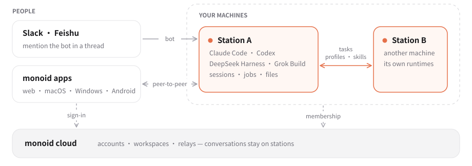

<a href="https://monoid.build"></a>

<p align="center">
<a href="https://monoid.build"><b>Website</b></a> ·
<a href="https://app.monoid.build"><b>Web app</b></a> ·
<a href="#download">Download</a> ·
<a href="#get-started">Get started</a> ·
<a href="https://monoid.build/status">Status</a> ·
<a href="README.zh-CN.md">简体中文</a>
</p>

<p align="center">
<a href="LICENSE"></a>


</p>

**monoid joins the coding agents on all your computers into one.** Every computer you add runs a **station**. The agents signed in there (Claude Code, Codex, Cursor and [others](#agents)) share **one account pool**, your **team** works with them where it already talks (Slack, Feishu, [Comma](https://comma.surf) or monoid's own chats), and **every device** picks up where you left off. Chats, files and jobs stay on your stations; clients reach them peer to peer.

## What you get

| | |
| --- | --- |
| **One pool, no limit left unused** | The accounts signed in on every station of a workspace are used as one. A new chat goes to a working account with the chosen model that resets soonest with the most left; accounts that are signed out, refused or out of quota are skipped. When a chat has to move, the agent reads its history back. |
| **One asks, the team carries on** | Mention the bot in a Slack thread or a Feishu (Lark) group, bring a station's agents into a Comma Task, or open a chat in the app. Everyone in the conversation works with the same agent. |
| **Computers that work as one** | Stations run on macOS, Linux and Windows. Agents run tasks and open chats on other stations, syncing only the changed files, and stations lend each other profiles and skills. New tasks go to the least busy machine. |
| **Your machine, from anywhere** | Browse and share its files, see and drive its browser or desktop, finish a CLI's sign-in from a card in the app, or lend the agent your Android phone. |
| **Sessions that persist** | Each chat keeps its working directory, history and memory. Builds, watches and web previews keep running as jobs after the turn ends, and report back when they finish. |
| **Peer to peer** | Clients connect to stations over [iroh](https://github.com/n0-computer/iroh), directly on the local network or through an end-to-end encrypted relay. Conversations are stored on stations, not in the cloud. |
| **Safe mode** | Optionally, members, devices and stations are accepted only when signed by trusted devices, so the cloud alone cannot grant access. A vault keeps the credentials agents use encrypted and hands them out only after a person approves. |

### Agents

Claude Code, Codex, Cursor, Devin, Grok Build, DeepSeek Harness, Hermes Agent, Antigravity CLI and Pi, each signed in with its own subscription, or with an API key from a provider (OpenAI, Anthropic, Google Gemini, DeepSeek, Kimi, OpenRouter and others).

## Download

| Platform | |
| --- | --- |
| **Web** | [app.monoid.build](https://app.monoid.build): nothing to install, on Linux, iPhone and iPad too |
| **Mac** (Apple silicon) | [Download](https://app.monoid.build/releases/latest/mac) |
| **Windows** (x64) | [Download](https://app.monoid.build/releases/latest/win) |
| **Android** | [Download](https://app.monoid.build/releases/latest/android) |

Free for now. Agents use your own subscriptions or API keys.

## Get started

1. Open the [web app](https://app.monoid.build) or one of the apps above, and create a workspace.
2. Choose **Add station** and run the command it shows on the computer that will run your agents. Stations run on macOS (Apple silicon), Linux (x64, arm64) and Windows (x64):

   ```sh
   curl -fsSL https://app.monoid.build/install.sh | sh -s -- <token>
   ```

3. Sign in to one of the [agents](#agents) on that station, or give it a provider's API key; the account joins the pool. Those runtimes and their accounts are separate from this project, and agents run with that computer's user permissions: read the [trust boundary](SECURITY.md#trust-boundary) first.
4. Start a chat in the app, or connect a Slack or Feishu bot (or Comma) to the station and mention it in a thread.

## How it works

<picture>
  <source media="(prefers-color-scheme: dark)" srcset="docs/images/architecture-dark.svg">
  
</picture>

- A **station** (`station/`, TypeScript on Node, with a few prebuilt native parts and a reader in MoonBit) runs on a computer you choose. It starts and keeps the agent sessions, connects to Slack, Feishu and Comma, and stores conversations locally in SQLite. Nothing reaches it from outside except over the mesh.
- A **workspace** groups people and stations. The cloud (`cloud/`, Cloudflare Workers) is the account system and nothing else: accounts, workspaces, member credentials and the relays. Conversation content never passes through it.
- **Clients** are one app on every platform, written in MoonBit on the mbui UI framework (`apps/mbui/`, `libs/mbui`). They share one client core in TypeScript (`client/core-ts`), which caches the workspace's data and keeps it in sync with the stations.

## Build from source

[docs/development.md](docs/development.md) covers toolchains, builds and an isolated local setup: a local control plane with mock sign-in, a local relay and a disposable station. The cloud tests run without any accounts:

```sh
git clone https://github.com/AFK-surf/monoid.git
cd monoid
pnpm install --frozen-lockfile
cd cloud && pnpm install --frozen-lockfile && pnpm run types && pnpm test
```

**Self-hosting**: the cloud runs on workerd outside Cloudflare, with its names, relay and sign-in your own; see [cloud/selfhost](cloud/selfhost/README.md) and [Production self-hosting](docs/development.md#production-self-hosting).

### One codebase, two products

This repository builds **monoid** ([monoid.build](https://monoid.build); test channel monoid.zone) and **still.fail** ([still.fail](https://still.fail); test channel youdid.wtf), the same code under two names. The product is chosen by the cloud a client signs in to (`client/i18n/brand.ts`) and by the app flavor it is built as (`apps/mbui/mbui.json`). Internal names (the `stillfail` command, `~/.stillfail`, `STILLFAIL_*` variables and the `@stillfail/*` packages) are shared by both and kept for compatibility with installed stations.

## Privacy and telemetry

Clients send operation traces (names, timings and errors, without message content) to the cloud they are signed in to. Product analytics (PostHog) are only included when a key is supplied at build time, so builds from this repository have none; station error reports are off unless the station's operator enables them. App builds from this repository connect to the hosted still.fail cloud unless built as a monoid flavor. See the [privacy policy](https://monoid.build/en/privacy).

## Repository

| Path | Contents |
| --- | --- |
| `station/` | The station: agent runtimes, Slack and Feishu, jobs, files, screens, vault; native parts in `station/native/` |
| `client/` | Shared client core (`core-ts`), its native shell (`shell`, Rust), the browser's iroh (`iroh-wasm`) and translations (`i18n`) |
| `apps/mbui/` | The apps (Android, iOS, macOS, Windows, Linux and the web), written in mbui (`libs/mbui`) |
| `libs/` | mbui, the component libraries and the MoonBit base |
| `web/` | The web's host of the app, and its sign-in, share and admin pages |
| `website/` | The official sites (monoid.build, still.fail) |
| `cloud/` | Accounts, workspaces, relays and releases on Cloudflare |
| `rules/` | Rules shared by the station, the cloud and the core, in MoonBit built to JavaScript |
| `scripts/` | Checks, releases and the CI plan |
| `design/` | Brand assets and icons |
| `docs/` | Development and operation notes; release notes in `docs/releases/` |
| `test/` | Integration and browser tests |
| `vendor/` | Patched third-party code |

## Documentation

- [Development setup](docs/development.md) and [contributing](CONTRIBUTING.md)
- [Operations](docs/operations.md): how the maintainers build and deploy the hosted service
- [Security](SECURITY.md): private reporting and the station's trust boundary
- [Linux desktop setup](docs/linux-desktop-setup.md): what a Linux station needs to share its desktop
- [LAN connections behind an outbound firewall](docs/station-lan-firewall.md): a fixed mesh port for a firewalled station

## Status

monoid is under active development and pre-1.0. Versions are `0.1.<n>`; the beta channel follows `main`, and stable releases are published from reviewed release notes (in Chinese) in [docs/releases](docs/releases). Stations, clients and the cloud update independently, so every change keeps older and newer versions working together.

## License

[MIT](LICENSE). Vendored code, dependencies and third-party marks retain their own licenses; see [third-party notices](THIRD_PARTY_NOTICES.md).
