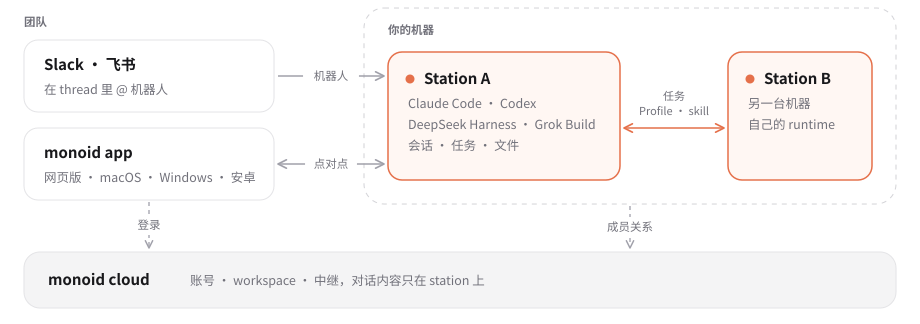

<a href="https://monoid.build/zh/"></a>

<p align="center">
<a href="https://monoid.build/zh/"><b>官网</b></a> ·
<a href="https://app.monoid.build"><b>网页版</b></a> ·
<a href="#下载">下载</a> ·
<a href="#开始使用">开始使用</a> ·
<a href="https://monoid.build/status">服务状态</a> ·
<a href="README.md">English</a>
</p>

<p align="center">
<a href="LICENSE"></a>


</p>

**monoid 把每台电脑上的 coding agent 连成一台。** 加进来的每台电脑运行一个 **station**，上面登录的 agent（Claude Code、Codex、Cursor 等，见 [agent](#agent)）共用**一个号池**；**团队**在原本聊天的地方（Slack、飞书、[Comma](https://comma.surf) 或 monoid 自己的对话）指挥它们；**每台设备**都能接着干。对话、文件和后台任务都留在你的 station 上，客户端点对点连接 station。

## 能做什么

| | |
| --- | --- |
| **一个号池，额度一点不浪费** | 同一 workspace 各台 station 上登录的账号合起来用。新对话交给有所选模型、可用、最快重置且剩余最多的账号，跳过登录失效、被拒绝或额度用尽的账号。对话不得不换号时，agent 自己读回聊天记录。 |
| **一个人开口，整个团队接着干** | 在 Slack thread 或飞书（Lark）群里 @ 机器人，把 station 的 agent 拉进 Comma 的 Task，或在 app 里新建对话。同一个对话里的人和同一个 agent 协作。 |
| **几台电脑合成一台** | station 支持 macOS、Linux 和 Windows。agent 能把任务交给另一台 station、在那里开对话，只同步改动的文件；station 之间可以借用 Profile 和 skill，新任务交给最空闲的机器。 |
| **随时随地用你的电脑** | 浏览和分享它的文件，查看并操作它的浏览器或桌面，在 app 的卡片里完成命令行工具的登录，或者把安卓手机借给 agent。 |
| **会话一直在** | 每个对话保留自己的工作目录、历史和记忆。构建、监控、网页预览在一轮结束后作为后台任务继续运行，结束时回到对话里报告。 |
| **点对点** | 客户端经 [iroh](https://github.com/n0-computer/iroh) 连接 station，局域网内直连，否则经端到端加密的中继。对话存在 station 上，不存在云端。 |
| **安全模式** | 可选：workspace 的成员、设备和 station 必须由受信任设备签名批准，仅凭云端无法授予访问权限。密钥库加密保存 agent 要用的凭据，经人批准才交给 agent。 |

### agent

Claude Code、Codex、Cursor、Devin、Grok Build、DeepSeek Harness、Hermes Agent、Antigravity CLI 和 Pi，可以登录各自的订阅，也可以填服务商的 API key（OpenAI、Anthropic、Google Gemini、DeepSeek、Kimi、OpenRouter 等）。

## 下载

| 平台 | |
| --- | --- |
| **网页版** | [app.monoid.build](https://app.monoid.build)：无需安装，Linux、iPhone、iPad 上也能用 |
| **Mac**（Apple 芯片） | [下载](https://app.monoid.build/releases/latest/mac) |
| **Windows**（x64） | [下载](https://app.monoid.build/releases/latest/win) |
| **安卓** | [下载](https://app.monoid.build/releases/latest/android) |

目前免费。agent 用你自己的订阅或 API key。

## 开始使用

1. 打开[网页版](https://app.monoid.build)或上面任一 app，创建 workspace。
2. 选择「添加 station」，在要运行 agent 的电脑上执行页面给出的命令。station 支持 macOS（Apple 芯片）、Linux（x64、arm64）和 Windows（x64）：

   ```sh
   curl -fsSL https://app.monoid.build/install.sh | sh -s -- <token>
   ```

3. 在那台 station 上登录某个 [agent](#agent)，或填入服务商的 API key，账号就进了号池。这些 runtime 及其账号与本项目无关，agent 以那台电脑的用户权限运行，请先阅读[信任边界](SECURITY.md#trust-boundary)。
4. 在 app 里新建对话，或为 station 连接 Slack、飞书机器人（或 Comma），然后在 thread 里 @ 它。

## 工作原理

<picture>
  <source media="(prefers-color-scheme: dark)" srcset="docs/images/architecture-zh-dark.svg">
  
</picture>

- **station**（`station/`，运行在 Node 上的 TypeScript，带少量预编译的原生组件和一个 MoonBit 写的读取程序）运行在你选定的电脑上。它启动并保持 agent 会话，连接 Slack、飞书和 Comma，把对话存在本地 SQLite 里。除了 mesh，外界没有任何入口能连到它。
- **workspace** 把人和 station 组织在一起。云端（`cloud/`，Cloudflare Workers）只是账号系统：账号、workspace、成员凭证和中继。对话内容从不经过它。
- **客户端**是各平台同一个 app，用 MoonBit 和 mbui 界面框架写（`apps/mbui/`、`libs/mbui`）。它们共用一个 TypeScript 写的客户端 core（`client/core-ts`），它缓存 workspace 的数据，并与各 station 保持同步。

## 从源码构建

[docs/development.md](docs/development.md) 介绍了工具链、构建方法和一套隔离的本地环境：带模拟登录的本地控制面、本地中继和一次性 station。cloud 的测试不需要任何账号：

```sh
git clone https://github.com/AFK-surf/monoid.git
cd monoid
pnpm install --frozen-lockfile
cd cloud && pnpm install --frozen-lockfile && pnpm run types && pnpm test
```

**自托管**：云端可以脱离 Cloudflare 跑在 workerd 上，域名、中继和登录方式都用你自己的，见 [cloud/selfhost](cloud/selfhost/README.md) 和[生产环境自托管](docs/development.md#production-self-hosting)。

### 一套代码，两个产品

本仓库同时构建 **monoid**（[monoid.build](https://monoid.build)，测试渠道 monoid.zone）和 **still.fail**（[still.fail](https://still.fail)，测试渠道 youdid.wtf），是同一套代码的两个名字。客户端是哪个产品，由它登录的云端（`client/i18n/brand.ts`）和构建时的 app 版本（`apps/mbui/mbui.json`）决定。内部名称（`stillfail` 命令、`~/.stillfail`、`STILLFAIL_*` 环境变量、`@stillfail/*` 包）两个产品共用，为兼容已安装的 station 保留不改。

## 隐私和遥测

客户端向它登录的云端发送操作 trace（名称、耗时和错误，不含消息内容）。产品分析（PostHog）只在构建时提供了 key 才会包含，因此从本仓库构建的版本不带；station 的错误报告默认关闭，由 station 的管理者决定是否开启。从本仓库构建的 app 默认连接托管的 still.fail 云端，按 monoid 版本构建的除外。见[隐私政策](https://monoid.build/privacy)。

## 仓库结构

| 路径 | 内容 |
| --- | --- |
| `station/` | station：agent runtime、Slack 和飞书、任务、文件、屏幕、密钥库；原生组件在 `station/native/` |
| `client/` | 共用的客户端 core（`core-ts`）、它的原生外壳（`shell`，Rust）、浏览器用的 iroh（`iroh-wasm`）和翻译（`i18n`） |
| `apps/mbui/` | 各端 app（安卓、iOS、macOS、Windows、Linux 和网页），用 mbui（`libs/mbui`）写 |
| `libs/` | mbui、组件库和 MoonBit 基础库 |
| `web/` | 网页上运行 app 的宿主，以及登录、分享和管理后台页面 |
| `website/` | 官网（monoid.build、still.fail） |
| `cloud/` | Cloudflare 上的账号、workspace、中继和发布 |
| `rules/` | station、cloud 和 core 共用的规则，MoonBit 写、编译成 JavaScript |
| `scripts/` | 检查、发布和 CI 计划 |
| `design/` | 品牌素材和图标 |
| `docs/` | 开发和运维文档；发布说明在 `docs/releases/` |
| `test/` | 集成测试和浏览器测试 |
| `vendor/` | 打过补丁的第三方代码 |

## 文档

- [开发环境](docs/development.md)和[贡献指南](CONTRIBUTING.md)
- [运维](docs/operations.md)：维护者如何构建和部署托管服务
- [安全](SECURITY.md)：私下报告漏洞的方式，以及 station 的信任边界
- [Linux 桌面控制](docs/linux-desktop-setup.md)：Linux station 共享桌面需要装什么
- [出站防火墙后的局域网连接](docs/station-lan-firewall.md)：给有防火墙的 station 固定 mesh 端口

## 状态

monoid 正在活跃开发中，尚未到 1.0。版本号是 `0.1.<n>`；测试版跟随 `main`，正式版依据 [docs/releases](docs/releases) 里审阅过的发布说明发布。station、客户端和云端各自更新，所有改动都保证新旧版本可以一起工作。

## 许可

[MIT](LICENSE)。内置的第三方代码、依赖和第三方商标保留各自的许可，见[第三方声明](THIRD_PARTY_NOTICES.md)。
